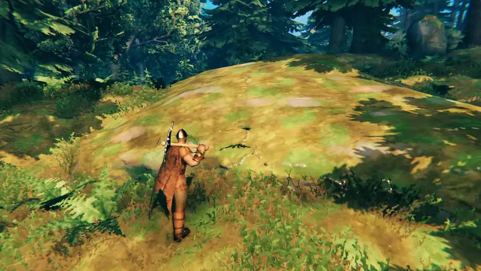
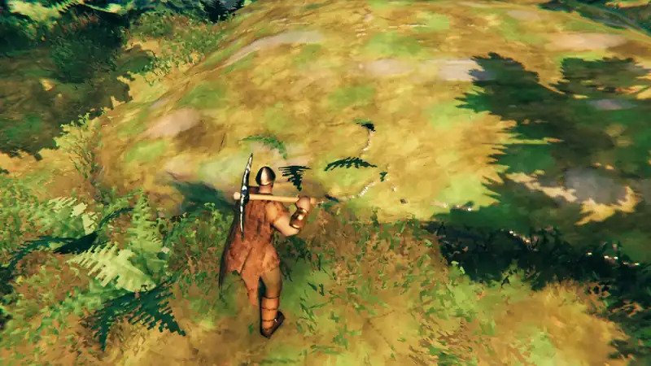
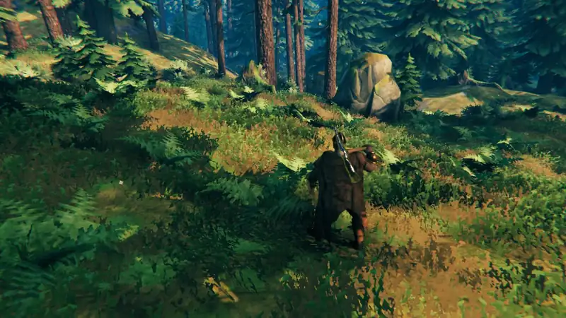

# Demonstration

## Hitting a vein

Each pickaxe hit sends a ring over the copper vein, and a second hit starts a new one without cutting off the first:

Up close, the ring turns red where the vein goes under the ground:

## Buried ore

Hitting plain grass shows the vein hidden a few meters below it:

